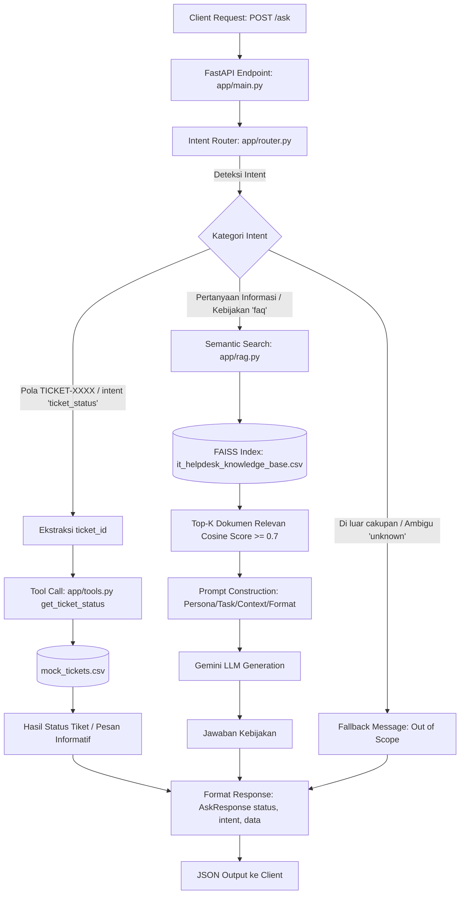

# IT Helpdesk Assistant — End-to-End RAG & AI Agent

Aplikasi backend API berbasis **FastAPI**, **RAG (Retrieval-Augmented Generation)** dengan **FAISS**, dan **Workflow Routing (Mini-Agent / Tool Call)** untuk mengotomatisasi penanganan pertanyaan karyawan pada tim *People & IT Operations*.

Seluruh konfigurasi sensitif (API key) dikelola melalui environment variable tanpa *hardcode*, dan aplikasi dapat dijalankan secara konsisten baik di lingkungan lokal maupun dalam container **Docker**.

---

## 1. Problem Statement & Pemahaman Use Case

### 1.1 Objective
Tim People & IT Operations setiap harinya menerima ratusan pertanyaan repetitif dari karyawan. Sebagian besar pertanyaan tersebut dapat dikelompokkan ke dalam dua ranah yang membutuhkan cara penanganan berbeda:
1. **Pencarian Informasi / Kebijakan Umum** yang membutuhkan penalaran semantik terhadap dokumen internal perusahaan.
2. **Pengecekan Status Transaksional Spesifik** yang membutuhkan data riil terkini secara pasti (deterministik), bukan perkiraan semantik.

Tujuan dari sistem ini adalah membangun asisten AI tunggal yang mampu menerima query dalam bahasa alami, mendeteksi kebutuhan user (*intent detection*), lalu secara cerdas merutekannya ke komponen yang tepat (**RAG** untuk informasi kebijakan, atau **Tool Call** untuk data status tiket), dan mengembalikan jawaban dalam format terstruktur yang konsisten.

### 1.2 Dua Jenis Permintaan User
| Jenis Permintaan | Intent Code | Komponen Penangan | Karakteristik & Contoh Query |
|---|---|---|---|
| **Informasi / Kebijakan Umum** | `faq` | **RAG System** (FAISS + Gemini LLM) | Pertanyaan seputar aturan, fasilitas, dan prosedur HR/IT.<br>• *"Berapa jatah cuti tahunan untuk karyawan tetap?"*<br>• *"Bagaimana cara reset password VPN perusahaan?"*<br>• *"Kapan slip gaji bulanan bisa diunduh?"* |
| **Pengecekan Data Spesifik** | `ticket_status` | **Tool Call** (`get_ticket_status`) | Permintaan status atau progres dari tiket tertentu milik karyawan.<br>• *"Tolong cek status tiket TICKET-0005 saya"*<br>• *"Apa status tiket TICKET-0099?"*<br>• *"Tiket nomor 3 sudah sampai mana?"* |

### 1.3 Batasan & Asumsi Sistem
1. **Cakupan Knowledge Base**: Data kebijakan terbatas pada 31 FAQ internal yang terdapat pada `data/it_helpdesk_knowledge_base.csv`. Pertanyaan di luar topik tersebut tidak akan dijawab spekulatif oleh LLM (*grounded answer*).
2. **Data Tiket Mock**: Data tiket bersumber dari `data/mock_tickets.csv` dengan format nomor tiket `TICKET-XXXX` (4 digit angka).
3. **Stateless API**: Setiap request ke `/ask` bersifat independen (tanpa session / multi-turn chat history).
4. **Keamanan Kredensial**: `GEMINI_API_KEY` dikelola via file `.env` (lokal) atau passing flag `--env-file` (Docker). File `.env` tidak pernah di-commit ke Git.
5. **Single Container Service**: Sesuai brief tugas, backend API dikemas dalam satu image Docker berbasis `python:3.11-slim` tanpa memerlukan orchestrator multi-container (Docker Compose).

---

## 2. Desain Workflow Aplikasi

### 2.1 Diagram Alur Sistem


### 2.2 Kriteria yang Membedakan Intent `faq` dan `ticket_status`
Router menggunakan arsitektur **Hybrid Routing (3 Lapis)** untuk mencapai akurasi tinggi sekaligus efisiensi latensi dan biaya:

1. **Lapis 1 — Regex Fast-Path (`ticket_status`)**:
   - Jika query mengandung pola penulisan tiket seperti `TICKET-XXXX`, `tiket 5`, `tiket no 3`, atau `ticket #0005`, sistem langsung menetapkannya sebagai `ticket_status` secara deterministik tanpa perlu memanggil LLM (menghemat kuota dan memangkas latensi hingga ~0 ms).
2. **Lapis 2 — LLM Structured Classifier (`faq` vs `ticket_status` vs `unknown`)**:
   - Jika query tidak memuat nomor tiket eksplisit (contoh: *"Tiket saya kemarin sudah diproses belum?"*), query dikirim ke Gemini dengan *Structured Output* (Pydantic enum: `faq`, `ticket_status`, `unknown`).
   - Kriteria `faq`: Pertanyaan bersifat umum tentang hak, prosedur, panduan, atau ketentuan. Termasuk *"Bagaimana cara mengajukan tiket laptop?"* (karena ini pertanyaan prosedur, bukan cek status tiket).
   - Kriteria `ticket_status`: User menyatakan ingin mengetahui status/progres tiket miliknya.
   - Kriteria `unknown`: Pertanyaan tidak relevan dengan ranah HR & IT internal perusahaan (misal trivia, cuaca, politik, matematika).
3. **Lapis 3 — Keyword Fallback (High-Availability)**:
   - Jika terjadi kendala jaringan atau kegagalan pemanggilan LLM pada tahap klasifikasi, router otomatis beralih ke rule-based keyword matching agar sistem tidak *crash* (*graceful degradation*).

---

## 3. Struktur Direktori Proyek

```
it-helpdesk-assignment/
├── app/
│   ├── __init__.py
│   ├── main.py          # Entry point FastAPI, lifespan startup indexing, error handling
│   ├── router.py        # Hybrid intent detection, entity extraction, handler routing
│   ├── rag.py           # FAISS index builder, semantic search, prompt builder, LLM answer
│   ├── tools.py         # Deterministik tool get_ticket_status dengan error handling
│   └── llm.py           # Shared Gemini client (lazy-loaded, managed environment variables)
├── data/
│   ├── it_helpdesk_knowledge_base.csv  # 31 data FAQ internal HR & IT
│   └── mock_tickets.csv                # 15 data mock tiket helpdesk
├── scripts/
│   └── test_scenarios.sh               # Skrip pengujian otomatis 5 skenario + edge cases
├── Dockerfile           # Konfigurasi containerized backend berbasis python:3.11-slim
├── .dockerignore        # Mengabaikan .env, cache, dan file non-produksi dari build context
├── .gitignore           # Memastikan .env asli tidak ikut ter-commit ke Git
├── .env.example         # Template konfigurasi environment variables
├── requirements.txt     # Daftar pustaka runtime Python
└── README.md            # Dokumentasi komprehensif sistem
```

---

## 4. Cara Menjalankan Aplikasi

### 4.1 Menjalankan Secara Lokal (Tanpa Docker)

#### Prasyarat:
- Python 3.10, 3.11, atau yang kompatibel.
- API Key Gemini (dapat diperoleh gratis dari [Google AI Studio](https://aistudio.google.com/apikey)).

#### Langkah-langkah:
1. **Clone Repository & Masuk ke Direktori**:
   ```bash
   git clone <url-repository-anda>
   cd it-helpdesk-assignment
   ```

2. **Buat Virtual Environment & Install Dependensi**:
   ```bash
   python3 -m venv .venv
   source .venv/bin/activate
   pip install -r requirements.txt
   ```

3. **Konfigurasi Environment Variable**:
   Salin `.env.example` menjadi `.env` lalu masukkan API Key Anda:
   ```bash
   cp .env.example .env
   ```
   Buka file `.env` dan perbarui nilainya:
   ```env
   GEMINI_API_KEY=AIzaSy...your_real_gemini_api_key_here
   GEMINI_MODEL=gemini-3.1-flash-lite-preview
   GEMINI_EMBEDDING_MODEL=gemini-embedding-001
   RAG_TOP_K=3
   RAG_MIN_SCORE=0.7
   ```

4. **Jalankan Aplikasi FastAPI**:
   ```bash
   uvicorn app.main:app --host 0.0.0.0 --port 8000 --reload
   ```
   *Saat startup, sistem akan otomatis membaca dataset FAQ, membuat embedding, dan menginisialisasi index FAISS ke dalam memory.*

5. **Akses Dokumentasi API**:
   Buka browser di `http://localhost:8000/docs` untuk melihat Swagger UI interaktif.

---

### 4.2 Menjalankan Menggunakan Docker

#### Prasyarat:
- Docker Engine atau Docker Desktop sudah terinstal dan berjalan.

#### Langkah-langkah:
1. **Build Docker Image**:
   ```bash
   docker build -t it-helpdesk-assistant .
   ```

2. **Jalankan Container**:
   Inject environment variables dari file `.env` secara aman tanpa mem-bake secret ke dalam image:
   ```bash
   docker run -d --rm --name it-helpdesk-app --env-file .env -p 8000:8000 it-helpdesk-assistant
   ```

3. **Verifikasi Status Container & Log Startup**:
   ```bash
   docker logs it-helpdesk-app
   ```
   *Output yang diharapkan menunjukkan FAISS index berhasil dibangun (31 dokumen, dimensi 3072) dan Uvicorn berjalan pada port 8000.*

4. **Hentikan Container** (jika selesai digunakan):
   ```bash
   docker stop it-helpdesk-app
   ```

---

## 5. Hasil Pengujian Skenario & Observasi

Pengujian dilakukan secara otomatis menggunakan skrip `scripts/test_scenarios.sh` terhadap container Docker yang berjalan di `http://localhost:8000`.

### 5.1 Ringkasan Hasil Pengujian (5 Skenario Wajib)

| No | Kategori Skenario | Query Uji | Intent Terdeteksi | Router Routing | HTTP Status | Response Data | Observasi Evaluasi |
|---|---|---|:---:|:---:|:---:|---|---|
| **1** | **RAG 1** (Kebijakan Cuti) | *"Berapa jatah cuti tahunan untuk karyawan tetap?"* | `faq` | **RAG Path** | `200 OK` | *"Karyawan tetap mendapatkan jatah 12 hari cuti tahunan. Jatah cuti tersebut dapat mulai diambil setelah Anda memiliki masa kerja minimal 3 bulan."* | **Akurat**: Router mengarahkan ke RAG. Retrieval menemukan FAQ ID 1 (similarity 0.829), LLM menjawab sesuai fakta dokumen tanpa halusinasi. |
| **2** | **RAG 2** (Kendala IT/VPN) | *"Bagaimana cara reset password VPN perusahaan?"* | `faq` | **RAG Path** | `200 OK` | *"Anda dapat melakukan reset password VPN secara mandiri melalui portal self-service IT. Jika akun Anda terkunci, silakan hubungi tim IT Support untuk mendapatkan bantuan lebih lanjut."* | **Akurat**: Router mengarahkan ke RAG. Retrieval menemukan FAQ ID 8 (similarity 0.803), jawaban padat dan instruktif. |
| **3** | **Tool Call 1** (Tiket Ada) | *"Tolong cek status tiket TICKET-0005 saya"* | `ticket_status` | **Tool Path** | `200 OK` | *"Tiket TICKET-0005 atas nama Dedi Kurniawan (kategori: Access) dengan subjek 'Reset password VPN gagal terus' saat ini berstatus: Diproses. Pembaruan terakhir pada 2026-08-27."* | **Akurat**: Router mendeteksi pola tiket via regex fast-path, mengekstrak ID `TICKET-0005`, memanggil `get_ticket_status` dan mengembalikan data persis dari CSV. |
| **4** | **Tool Call 2** (Tiket Tidak Ada) | *"Apa status tiket TICKET-0099?"* | `ticket_status` | **Tool Path** | `200 OK` | *"Tiket TICKET-0099 tidak ditemukan di sistem. Mohon periksa kembali nomor tiket Anda, atau hubungi tim IT Support jika Anda yakin nomor tersebut benar."* | **Akurat**: Router mengekstrak `TICKET-0099`, fungsi tool menangani ketidaksediaan data dengan pesan ramah dan informatif tanpa *crash*. |
| **5** | **Di Luar Cakupan** (Ambigu / OOS) | *"Siapa juara Piala Dunia 2022?"* | `unknown` | **Out-of-Scope Fallback** | `200 OK` (status: `"error"`) | *"Maaf, saya tidak memahami permintaan Anda atau permintaan tersebut di luar cakupan layanan People & IT Operations. Saya dapat membantu menjawab pertanyaan kebijakan HR/IT..."* | **Akurat**: LLM classifier mengenali bahwa query di luar lingkup domain HR/IT internal dan memberikan panduan batasan sistem kepada user. |

---

### 5.2 Pengujian Skenario Edge Cases Tambahan

| Kode | Kasus Uji | Query | Response / Perilaku Sistem |
|---|---|---|---|
| **E1** | User ingin cek tiket tanpa menyertakan ID | *"Tiket saya sudah sampai mana ya prosesnya?"* | Intent terdeteksi `ticket_status`. Tool merespons: *"Nomor tiket tidak ditemukan pada pertanyaan Anda. Mohon sertakan nomor tiket dengan format TICKET-XXXX..."* |
| **E2** | Variasi penulisan nomor tiket informal | *"cek tiket no 3 dong"* | Regex menormalisasi ke `TICKET-0003`. Tool mengembalikan data tiket Budi Santoso (*Menunggu Persetujuan*). |
| **E3** | Pertanyaan HR/IT yang tidak ada di Knowledge Base | *"Apakah kantor menyediakan parkir motor untuk karyawan?"* | Intent `faq`, namun skor retrieval tertinggi (0.665) berada di bawah ambang `0.70`. Guardrail aktif: *"Maaf, saya belum menemukan informasi terkait pertanyaan tersebut di knowledge base..."* |
| **E4** | Prosedur pembuatan tiket (mengandung kata 'tiket' tapi intent FAQ) | *"Bagaimana cara mengajukan permintaan laptop baru?"* | Router membedakan bahwa ini adalah intent `faq` (bukan cek status tiket). RAG menjawab prosedur pembuatan tiket via portal IT. |
| **E5** | Validasi input query kosong | `{"query": ""}` | HTTP `422 Unprocessable Content` dengan JSON terstruktur: `{"status": "error", "intent": "invalid_request", ...}` |

---

## 6. Keterbatasan Sistem (System Limitations)

Berdasarkan hasil perancangan dan pengujian end-to-end, ditemukan beberapa keterbatasan sistem yang dapat dikembangkan pada iterasi berikutnya:

1. **Stateless (Ketiadaan Multi-Turn Context Memory)**:
   - Sistem saat ini tidak menyimpan riwayat percakapan. Jika user bertanya *"Tiket saya sudah sampai mana?"* dan sistem meminta nomor tiket, user harus mengulang pertanyaannya secara lengkap beserta nomor tiket pada request berikutnya.
2. **Ketergantungan Kuota & Latensi External LLM API**:
   - Jika endpoint Gemini API mengalami *rate limiting* (HTTP 429) atau gangguan jaringan, endpoint `/ask` akan mengembalikan status `503 Service Unavailable`. Walaupun router memiliki fallback keyword, jawaban akhir RAG tetap bergantung pada ketersediaan LLM.
3. **Data Mock Bersifat Statis (In-Memory / CSV)**:
   - Modul tools membaca `mock_tickets.csv` secara lokal. Pada lingkungan enterprise sesungguhnya, fungsi ini perlu dihubungkan dengan database transaksional (PostgreSQL/MySQL) atau API helpdesk nyata (Jira Service Management, Zendesk, ServiceNow) dengan autentikasi berbasis identitas karyawan (JWT / OAuth2).
4. **Otorisasi Kepemilikan Tiket Belum Diimplementasikan**:
   - Sistem saat ini mengizinkan siapa saja yang mengetahui nomor `TICKET-XXXX` untuk melihat statusnya. Dalam sistem produksi, perlu ditambahkan mekanisme otorisasi untuk memverifikasi apakah pemohon adalah pemilik tiket atau manajer terkait.
5. **Pembaruan Knowledge Base Memerlukan Restart Service**:
   - Index FAISS saat ini di-cache di RAM saat startup aplikasi. Jika file CSV FAQ diperbarui, aplikasi harus di-restart agar index diperbarui, atau perlu disediakan endpoint webhook administratif (misal `POST /admin/reindex`).

---

## 7. Format Response API

Endpoint `POST /ask` selalu mengembalikan JSON dengan tiga key konsisten:
```json
{
  "status": "success",
  "intent": "faq",
  "data": "Karyawan tetap mendapatkan jatah 12 hari cuti tahunan..."
}
```
Atau jika terjadi kesalahan / di luar cakupan:
```json
{
  "status": "error",
  "intent": "unknown",
  "data": "Maaf, saya tidak memahami permintaan Anda..."
}
```
